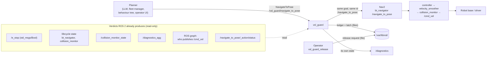
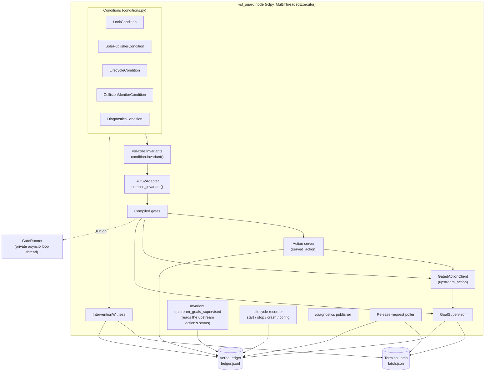

# vsl-ros2 architecture

This document is for the engineer who has to decide whether `vsl_guard` fits their robot, and then integrate it. It covers:

- where the guard sits;
- what it reads, and what it decides;
- what it writes;
- how it fails.

The other documents are listed in the [docs index](README.md).

## 1. The idea in one paragraph

ROS 2 and Nav2 already keep a robot safe *while it moves*: the collision monitor stops it, the velocity smoother limits it, controllers clamp it, diagnostics rate its health. What they don't have is:

- **a decision point before a task starts** that takes all of those verdicts into account;
- **supervision of a task while it runs** (an e-stop, a crash or a bypass shouldn't leave a goal alive);
- **a Terminal State** that only a named human can leave;
- **a tamper-evident record** of every decision, including the ones ROS 2's own safety functions made.

`vsl_guard` adds exactly those. It **never re-implements** a ROS 2 safety function. It reads their verdicts.

## 2. Where it sits



- The planner talks to the guard, never to Nav2. The guard serves **the same action type** as the server it protects, so to the planner it looks exactly like Nav2.
- The guard forwards an accepted goal to Nav2 **under the same goal id**. A goal's decision, any cancel and its record all share one id.
- Everything downstream of Nav2 is untouched: the controller, the velocity smoother, the collision monitor, the driver.

## 3. What happens to a goal

```mermaid
sequenceDiagram
    autonumber
    participant P as Planner
    participant G as vsl_guard
    participant L as Ledger
    participant N as Nav2
    P->>G: send goal (NavigateToPose)
    G->>G: check every gating condition (cached verdicts, microseconds)
    alt a condition does not hold, or latched
        G->>L: decision: denied by <condition> → goal rejected
        G-->>P: REJECTED
    else all hold
        G-->>P: ACCEPTED
        G->>L: decision: every condition allowed
        G->>N: forward goal (same id)
        N-->>G: feedback
        G-->>P: feedback (relayed)
        loop every 0.1 s while running
            G->>G: still fit? (latch; cancel_running conditions)
        end
        alt robot stops being fit (e-stop latch, bypass, unhealthy)
            G->>L: decision: <reason> → cancel the running goal
            G->>N: cancel
            N-->>G: cancelled
            G->>L: verification: Nav2 accepted the cancel
            G-->>P: ABORTED
        else goal ends normally
            N-->>G: result
            G-->>P: result (SUCCEEDED / ABORTED / CANCELED)
        end
    end
```

The check before the goal is accepted is the F1 pre-commitment: it completes before Nav2 is asked to do anything. Supervision while the goal runs is what stops a goal surviving an e-stop.

## 4. Inside the guard



| Component | File | Responsibility |
|---|---|---|
| Conditions | `conditions.py` | Hold one ROS 2 function's latest verdict, fed by the node's own subscriptions and timers. They fail closed: not heard yet, stale or unreadable means "does not hold". |
| `ROS2Adapter` | `adapter.py` | Compiles vsl-core PreNodes and Invariants into gates. Passes vsl-core's conformance suite. Never imports rclpy. |
| `GateRunner` | `runner.py` | Runs the async gates from rclpy callbacks on a private asyncio thread. A gate that raises or exceeds its 1 s timeout blocks the action. |
| `GatedActionClient` | `integration.py` | Sends goals upstream only if the gates allow, and tracks accepted goals until they finish. |
| `GoalSupervisor` | `supervisor.py` | Re-checks running goals every 0.1 s. Cancels them when the latch trips or a `cancel_running` condition fails. |
| `InterventionWitness` | `witness.py` | Records each ROS 2 function's interventions (a collision-monitor STOP, an e-stop) and when they clear. Trips the latch for `terminal` conditions. |
| `TerminalLatch` | `runner.py` | The Terminal State, persisted to a file. Only a `HumanAuthorisedTransition` releases it. |
| `vsl_guard` | `guard_node.py` | Composes all of the above from a YAML file. It also holds the `upstream_goals_supervised` Invariant, records the guard's own lifecycle, publishes `/diagnostics` and applies release requests. |
| `vsl_guard_release` | `release_cli.py` | A named human requests a release, with evidence. |
| `vsl_guard_report` | `report.py` | Summarises a ledger: integrity, audit, lifecycle, decisions, interventions, Terminal States. |

## 5. Gate, record, or both: three roles a condition can play

The configuration decides, per condition, what the guard does with a ROS 2 verdict:

| Role | Config | Effect | Use it for |
|---|---|---|---|
| **Gate** | default | No goal is accepted while it fails. Interventions are recorded | e-stop, lifecycle active, `cmd_vel` publishers, health |
| **Record only** | `gate: false` | Never blocks; every intervention and clear is recorded | a ROS 2 function that already acts on its own verdict: **the collision monitor** |
| **Supervise** | `cancel_running: true` | Gate, and a failure mid-goal cancels the running goal | a `cmd_vel` bypass, unhealthy diagnostics |
| **Terminal** | `terminal: true` | Gate, and a failure enters the Terminal State: latch, cancel running goals, refuse goals until a human releases | e-stop |

Why the collision monitor is record-only: it stops and resumes the robot itself. It also publishes its state only when its action changes, so after a goal ends during a STOP the last state stays STOP until Nav2 drives again. Gating new goals on it would deadlock the robot; this was found against real Nav2. The guard gates on the collision monitor being *active* instead.

Why lifecycle conditions don't cancel running goals: Nav2 aborts its own goals when a server deactivates.

## 6. The guard's own lifecycle

A governance layer that restarts, crashes or is bypassed is where records usually have holes. The guard records its own lifecycle in the same ledger:

| Event | Detected by | Action | Ledger |
|---|---|---|---|
| Start | — | — | `MONITOR guard_started`: the configuration and its hash, the gating and record-only conditions, whether it starts latched, how the previous run ended |
| Configuration changed | hash differs from the last start | — | `SPECIFICATION_UPDATE` (old hash, new hash, the keys that changed) |
| Previous run crashed | last lifecycle record is a start, not a stop | check upstream for unsupervised goals | drift `MONITOR` → `PRE_NODE` → `VERIFICATION` |
| Goal running upstream without supervision | the upstream action's status topic, continuously | cancel it through the action's cancel service (or record only: `orphaned_goals: record`) | denial of `upstream_goals_supervised` → `PRE_NODE` → `VERIFICATION`, marked `orphaned` or `foreign` |
| Clean stop (SIGINT/SIGTERM) | signal | cancel every goal it supervises, then exit | the cancels, then `MONITOR guard_stopped` |
| `kill -9`, power loss | (can't be handled) | the next start finds and cancels the orphans | as "previous run crashed" |

## 7. The ledger

The guard writes vsl-core's `VerbaLedger`: an append-only JSONL file, hash-chained (each entry carries the previous entry's hash), checked by `verify_integrity()` and `audit()`. Every decision follows the shape vsl-core's audit expects:

```
gate denied (MONITOR, drift) ─► fallback taken (PRE_NODE) ─► fallback verified (VERIFICATION)
                                                                └► if terminal: TERMINAL ─► HUMAN_AUTHORISED_TRANSITION
```

| Entry | Written when | Key payload fields |
|---|---|---|
| `MONITOR` (gate decision) | each condition checked for a goal; each intervention | `primitive_name` (the condition), `allowed`, `rules_version`, `detail`, `subject` |
| `MONITOR` (lifecycle) | start, stop, crash | `event`, `previous_run`, `specification_hash` |
| `PRE_NODE` | a block or intervention: the fallback taken | `fallback` ("goal rejected", "cancel the running goal", ...), `reason` |
| `VERIFICATION` | the fallback's outcome | `result` (`SUFFICIENT` / `INSUFFICIENT`), `verified` |
| `TERMINAL` | a `terminal` condition fired | `terminal_state`, `reason`, `condition` |
| `HUMAN_AUTHORISED_TRANSITION` | a release | `authorised_by`, `authority`, `authorisation_evidence_hash` |
| `SPECIFICATION_UPDATE` | the configuration changed between runs | `from_hash`, `to_hash`, `changed` |

The ledger records *decisions and interventions*, not every message. A 2-minute demo with 9 scenarios wrote 79 entries. `vsl_guard_report` summarises a ledger, or exports it as JSON.

## 8. Threads, clocks and timing

- **Executor.** `vsl_guard` runs a `MultiThreadedExecutor`. Condition callbacks, the action server and the upstream client share a reentrant callback group.
- **Gates never call into ROS.** They read verdicts the conditions have cached, so a gate can't deadlock the executor, and checking the whole chain costs microseconds plus one thread hand-off to the `GateRunner`.
- **Steady clock.** The guard's own timers (graph polling, expiry, supervision, release polling, diagnostics) run on the steady clock even with `use_sim_time`. Safety checks must not stop when simulation time pauses.
- **Latencies measured in the demo:**
  - e-stop to running goal cancelled: 0.2–0.3 s;
  - foreign goal cancelled before the robot moved;
  - after `kill -9`, the respawned guard cancelled the orphan 3–5 s after the kill. Nav2 drove 0.24–0.30 m in that gap.

## 9. Failure modes

| Failure | What the guard does | Residual risk |
|---|---|---|
| A verdict source goes silent (e-stop panel, diagnostics) | That condition stops holding (fail closed): goals refused; `cancel_running` and `terminal` conditions act on running goals | — |
| A gate raises or hangs | Blocked after the 1 s timeout | — |
| Nav2 doesn't accept the forwarded goal within 10 s | The planner's goal is aborted | — |
| Nav2 refuses a cancel | Logged as an error; recorded as `INSUFFICIENT`, which `audit()` flags | The goal is still running: an operator must act |
| Ledger can't be written | Before forwarding: the goal isn't sent. While rejecting: still rejected, the missing record is logged | A refusal without its record |
| Latch file unreadable | Treated as latched | — |
| Guard crashes | `ros2 launch` respawns it (2 s). It records the crash and cancels the orphaned goals | Nav2 keeps driving for the gap. A hardware e-stop is the real protection |
| Someone sends goals to Nav2 directly | Cancelled as `foreign`, and recorded | Detected after Nav2 accepts. Prevent it with SROS2 |
| Someone publishes on `/cmd_vel` | `cmd_vel_publishers` fails: running goals cancelled, new goals refused | The rogue commands themselves reach the driver: the guard can't filter a topic it isn't on. Prevent with SROS2 |

## 10. Security model

- **Release** is a file written next to the latch (`vsl_guard_release`). Access control is the robot's own: who can log in and write to the guard's state directory. There is deliberately no ROS service, which would let anyone on the DDS domain release the robot.
- **The ledger** is tamper-evident (hash chain), not tamper-proof: someone with write access can delete it. Copy it off the robot if it must survive. vsl-core also ships an immudb store for an independently verifiable ledger.
- **Bypass** is detected (`cmd_vel_publishers`, `upstream_goals_supervised`), not prevented. Prevention is SROS2 permissions: only the guard may call Nav2's action, and only the intended nodes may publish on `/cmd_vel`.

## 11. What it is not

- **Not functional safety.** It runs in a Python process on a general-purpose OS over DDS. It doesn't replace a hardware e-stop, a safety-rated controller or the certification your robot needs (ISO 10218, ISO 13482, IEC 61508 and similar). It governs what the *software* decides, above those layers.
- **Not a motion filter.** It doesn't sit on `cmd_vel` and doesn't limit speed; Nav2 does that.
- **Not hard real-time.** Decisions take microseconds to milliseconds; supervision runs at 10 Hz.

## 12. Mapping to VSL (vsl-core) constructs

| VSL construct | In vsl-ros2 |
|---|---|
| `Invariant` | each condition (`condition.invariant()`), and `upstream_goals_supervised` |
| `PreNode` + `GammaEstimate` | available in the Python API for policies with a measurable margin; the shipped guard uses none (ROS 2 functions give verdicts, not margins) |
| F1 pre-commitment | the gate check completes before the goal is accepted, and before it is forwarded |
| Assurance | none declared: conditions and the supervision Invariant are built without an `assurance_basis`. Whether a gate held before its side effect is computed from the ledger (`VerbaLedger.enforcement`), from action records the application writes |
| `TerminalState` | `terminal_state` in the config; entered through a `terminal: true` condition |
| `HumanAuthorisedTransition` | `vsl_guard_release`: a named approver, a `GovernanceAuthority` and evidence |
| `Specification` update | `SPECIFICATION_UPDATE` when the configuration hash changes between runs |
| `VerbaLedger` / `audit()` | the guard's ledger; `vsl_guard_report` runs `audit()` |
